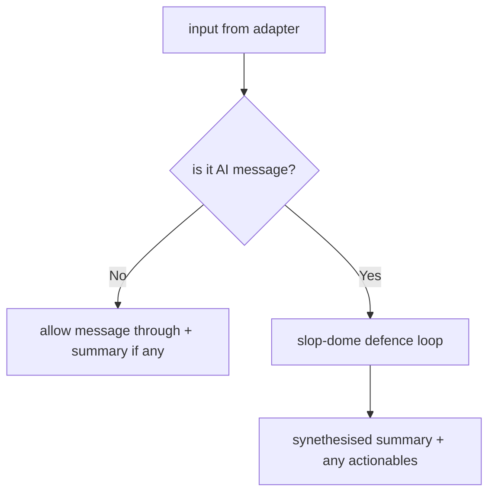

# The core loop

```
input -> slop-dome defence loop -> final outcome / summary if any
```

# The filtering algorithm



## Logic: Is AI message

# Interception mechanism (adapters)

- Slack adapter
- Whatsapp adapter
- Email adapter
